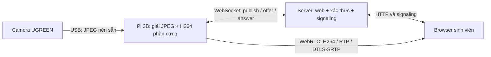

# digital_twin_cam

Project camera độc lập cho Raspberry Pi 3B: nhận MJPEG từ camera USB,
**thử mã hóa H.264 bằng phần cứng Pi**, rồi phát WebRTC đến browser của web chính thức.
Không cần PC làm máy mã hóa. Không chứa gateway, MQTT, backend web hoặc dữ liệu của repo cũ.

**Trạng thái:** nền tảng thử nghiệm, chưa nghiệm thu toàn bộ camera thật → browser.
Xem [kết quả kiểm thử](docs/verification.md) để phân biệt kết quả PC và Pi.

## Gói bàn giao

Bắt đầu ở [HANDOVER.md](HANDOVER.md). Có [lệnh cài và systemd](docs/handover.md)
và [hợp đồng signaling](docs/integration-contract.md) cho bên web/backend.
Profile demo hai camera15FPS: config/pi-15fps.example.yaml;30FPS là thử nghiệm.

## Bản V2 đang dùng trên Pi

Source hiện tại gồm cải tiến V2 và cấu hình `video` dùng chung. Trên Pi dùng
`/home/thang/digital_twin_cam`, với `.venv` độc lập. Bản V1 được lưu trong
backup riêng trước khi bỏ thư mục chạy cũ. Không dùng lại gói `dist` cũ để triển
khai thay đổi này nếu chưa đóng gói lại.

```bash
cd /home/thang/digital_twin_cam
.venv/bin/dt-cam --config config/local.yaml check
.venv/bin/dt-cam --config config/local.yaml publish
```

Chỉ chạy một publisher. Dịch vụ MJPEG cũ `digital-twin-camera` phải được dừng
để không tranh camera; dịch vụ đó thuộc `/opt/digital_twin`, không thuộc V1/V2.

## Cấu hình video chung cho hai camera

Trong `config/local.yaml`, mục `video` áp dụng giống nhau cho mọi camera:

```yaml
video:
  width: 640
  height: 480
  fps: 15
  bitrate: 1000000
  gop: 15
```

Chỉ đổi `video.fps` một lần để đổi FPS của cả hai camera. `width`/`height`
là độ phân giải; `bitrate` là bit/s **mỗi camera**, không phải tổng.
`gop` độc lập với FPS; ví dụ 30 FPS với GOP 30 yêu cầu IDR khoảng mỗi giây.
Khi có `video`, từng mục trong `cameras` chỉ giữ `id`, `index`, `device`,
`enabled`; không lặp lại các trường video (loader sẽ báo lỗi).
YAML cũ không có `video` vẫn được hỗ trợ với cấu hình riêng từng camera.

Kiểm tra bằng `dt-cam --config config/local.yaml check`, sau đó dừng và chạy lại
publisher để áp dụng. Không tự đọc lại YAML trong lúc chạy. Gateway MQTT có thể
cập nhật mục `video`, kiểm tra file tạm rồi thay file và khởi động lại tiến trình.
Cấu hình hợp lệ không đảm bảo thiết bị hỗ trợ chế độ đó; cần thử camera thật.

## Luồng đã chốt



**Đúng với web chính thức đang triển khai:** server làm signaling, video đi Pi → browser.
“Phát lên web trên server” không có nghĩa video đi qua server. Nếu muốn server nhận
và phân phối video, phải làm thêm media relay; project này không tự sửa backend đó.
ZeroTier là mạng kết nối, không phải codec, signaling hay media server.

## Bố trí source

```text
src/digital_twin_cam/
  cli.py            # check / doctor / benchmark / publish, dừng sạch SIGINT/SIGTERM
  config.py         # đọc và kiểm tra YAML; đọc khóa từ file riêng
  diagnostics.py    # kiểm tra FFmpeg, camera, quyền, nguồn điện
  h264.py           # command hardware encoder, parse Annex-B, SPS/PPS, timestamp
  source.py         # vòng đời FFmpeg, chia packet, queue hữu hạn, IDR recovery
  signaling.py      # hợp đồng web chính thức và từng WebRTC peer
config/             # cấu hình ví dụ; local.yaml không vào Git
deploy/systemd/     # template chạy nền, chưa tự cài hoặc bật
scripts/            # cài môi trường Python
tests/              # cấu hình, bitstream, lifecycle và WebRTC hai người nhận
docs/               # C4, ADR, triển khai, benchmark và kết quả
```

Hướng dẫn thực hành đầy đủ từ Wi-Fi/ZeroTier đến tự chạy sau boot: [setup-from-scratch.md](docs/setup-from-scratch.md).

## 1. Chuẩn bị trên Pi

Python 3.11+, FFmpeg có `h264_v4l2m2m`, driver encode V4L2 hoạt động, camera hỗ trợ MJPG.
Camera UGREEN đã liệt kê MJPG/YUYV, không có H.264 trực tiếp; Pi đảm nhiệm encode H.264.

Chép project từ PC sang Pi, không chép `.venv` của PC:

```bash
# Trên PC, tạo gói source sạch, không chứa config local, khóa hoặc môi trường Python.
cd /home/ducvu/duanma/digital_twin_cam
tar --exclude='__pycache__' --exclude='*.egg-info' -czf /tmp/digital_twin_cam-src.tar.gz \
  pyproject.toml requirements.lock.txt README.md HANDOVER.md AGENTS.md .gitignore src config/pi.example.yaml config/pi-15fps.example.yaml config/pi-30fps.example.yaml deploy scripts tests docs
scp /tmp/digital_twin_cam-src.tar.gz thang@10.42.0.55:~/
```

IP là ví dụ đã dùng; xác nhận IP/khóa SSH đúng máy nếu cài lại Pi hoặc DHCP đổi.

```bash
# Trên Pi: giải nén vào thư mục mới, không đụng /opt/digital_twin.
mkdir -p ~/digital_twin_cam
cd ~/digital_twin_cam
tar -xzf ~/digital_twin_cam-src.tar.gz
sudo apt update
sudo apt install -y python3-venv ffmpeg v4l-utils
bash scripts/setup.sh
cp config/pi.example.yaml config/local.yaml
.venv/bin/dt-cam --config config/local.yaml check
.venv/bin/dt-cam --config config/local.yaml doctor
```

`setup.sh` chỉ tạo `.venv` và cài dependency; không mở camera, thay service hoặc kết nối web.
Không phải cài lại sau mỗi reboot. Sau reboot chỉ `cd` đúng thư mục rồi chạy lệnh.
Nếu báo permission thiết bị, kiểm tra `id` và `ls -l /dev/video*`; thêm user vào nhóm
`video` nếu thiếu, sau đó đăng nhập lại. Không chạy publisher bằng root để né quyền.

## 2. Thử phần cứng trước, chưa cần web hay khóa

Đọc [quy trình benchmark](docs/benchmark.md) trước khi mở thiết bị.
Mặc định chỉ bật camera1 640×480, 15 FPS để khoanh vùng. Chỉ một chương trình chiếm camera.
Nếu dịch vụ cũ đang dùng camera, chỉ dừng để thử khi đã chủ động ngừng phiên xem cũ:

```bash
sudo systemctl stop digital-twin-camera
cd ~/digital_twin_cam
mkdir -p artifacts
.venv/bin/dt-cam --config config/local.yaml benchmark \
  --camera-index 0 --seconds 20 --output artifacts/camera1-15fps.h264
ffprobe -v error -select_streams v:0 -count_frames \
  -show_entries stream=codec_name,profile,width,height,nb_read_frames,level \
  -of json artifacts/camera1-15fps.h264
ffmpeg -v error -i artifacts/camera1-15fps.h264 -f null -
```

`benchmark` mở camera thật, dùng duy nhất `h264_v4l2m2m`, tạo file mới và đóng FFmpeg
khi kết thúc. Có thêm thời gian chờ khởi tạo/IDR; không đồng nghĩa đúng 20 giây tính từ nhấn Enter.
Tên file cũ không được ghi đè. Không có fallback encode CPU khi phần cứng lỗi.
`ffprobe` đếm frame giải mã; lệnh FFmpeg sau kiểm tra lỗi decode. CPU/nguồn điện
cần đo song song, không suy từ FPS. JPEG decode/chuyển màu vẫn dùng CPU.

Nếu driver không nhận tùy chọn profile/level hoặc không mở được codec, giữ lại log để
chỉnh theo đúng bản FFmpeg/driver. Không coi việc liệt kê tên encoder là đã chạy được.
Nếu quay về bản cũ: dừng publisher mới trước, rồi `sudo systemctl start digital-twin-camera`.
Không chạy cả hai trên cùng `/dev/video0`/`/dev/video2`.

## 3. Ghép signaling với web chính thức

Khóa publish là mật khẩu dành cho chương trình phát camera, khác mật khẩu SSH và
khác token đăng nhập của sinh viên. Bên vận hành web cấp đúng khóa cho kit.
Không tạo khóa ngẫu nhiên rồi mong server chấp nhận.

```bash
# Trên Pi: tạo chỗ lưu khóa, không nằm trong source.
install -d -m 700 ~/.local/share/digital_twin_cam
```

Nếu dùng lại khóa chính thức đã có trên PC, thực hiện **trên PC**:

```bash
scp ~/.local/share/digital_twin/official-web-publisher.key \
  thang@10.42.0.55:~/.local/share/digital_twin_cam/publish.key
```

Sau đó **trên Pi**:

```bash
chmod 600 ~/.local/share/digital_twin_cam/publish.key
cd ~/digital_twin_cam
nano config/local.yaml
.venv/bin/dt-cam --config config/local.yaml publish
```

Trong YAML sửa `signaling.url`, `kit_code`, `publish_key_file`, các camera `device`.
Ví dụ endpoint chính thức `ws://10.147.19.155/signaling`; không dùng demo 8091 hoặc
cổng frontend 5173. `cameraIndex` 0/1 là thứ tự logic; `/dev/video0` và `/dev/video2`
là hai thiết bị vật lý. Dùng `/dev/v4l/by-path/...-video-index0` để tránh đổi số sau reboot.

Trước khi chạy, ngừng publisher PC cũ của cùng kit bằng Ctrl+C tại terminal của nó.
Không đăng ký hai publisher cho kit `123`, không tự chiếm publisher đang chạy.
Publisher mới chỉ thay nguồn video; **không triển khai MQTT heartbeat/telemetry**.
Web chính thức vẫn yêu cầu kit online, nhóm/lịch/lượt thực hành và người xem hợp lệ;
phần thiết bị/MQTT có sẵn phải đáp ứng hợp đồng đó. Không bỏ xác thực để thử camera.

Trên máy xem: có đường mạng tới server **và Pi**, vào web chính thức, đăng nhập
sinh viên có lượt hợp lệ rồi mở camera. Nếu dùng IP ZeroTier thì máy xem cần có
quyền mạng ZeroTier, trừ khi CNTT đã triển khai public access/TURN riêng.
`published` chỉ xác nhận đăng ký; `connected` chỉ xác nhận WebRTC, cần decoded frames tăng
và có hình để nghiệm thu. Signaling không mang JPEG hoặc H.264.

## 4. Sau reboot và tùy chọn chạy nền

Thử thủ công trước:

```bash
cd ~/digital_twin_cam
.venv/bin/dt-cam --config config/local.yaml doctor
.venv/bin/dt-cam --config config/local.yaml publish
```

Ctrl+C để dừng và giải phóng camera. Không phải compile Python lại sau khi sửa YAML.
Sau thay đổi dependency mới cần chạy `bash scripts/setup.sh` lại.
Chỉ cài systemd khi đã nghiệm thu; xem [deployment](docs/deployment.md).

## Giới hạn đã biết

- Một encoder phần cứng/camera, cùng chất lượng cho các người xem; bitrate cấu hình cố định.
  aiortc vẫn xử lý RTP, retransmission và mã hóa truyền tải từng peer, nhưng phản hồi REMB
  không tự chỉnh bitrate của FFmpeg ngoài tiến trình. Không mặc định mạng chậm sẽ được tối ưu riêng.
- PLI chưa điều khiển FFmpeg ép IDR tức thì; phục hồi chờ IDR định kỳ. Phải đo GOP thực tế.
- Queue hữu hạn, khi tràn bỏ chuỗi frame phụ thuộc rồi đợi IDR, tránh tích backlog vô hạn.
- Nhiều người xem tăng CPU packetization/SRTP và băng thông Pi. Hai camera chia sẻ USB/codec/nguồn;
  không hứa Pi3B chạy hai camera 30 FPS trước khi đo.
- `ws://` chỉ phù hợp thử trong mạng riêng tin cậy; public dùng WSS/HTTPS, ICE/TURN và
  cấu hình bảo mật do bên CNTT vận hành. Không tự mở firewall/router.
- Source hiện là bản thử nghiệm; chưa có tự điều chỉnh bitrate, instant PLI hay relay server.

## Tài liệu và kiểm thử

- [C4 và runtime](docs/README.md)
- Profile thử hai camera30FPS: [pi-30fps.example.yaml](config/pi-30fps.example.yaml); so sánh với15FPS theo hướng dẫn monitor trong benchmark.
- [Kế hoạch đo](docs/benchmark.md) · [kết quả thực tế](docs/verification.md)
- [Quyết định H.264](docs/adr/0001-hardware-h264.md)

```bash
.venv/bin/python -m unittest discover -s tests -v
```

Tests sinh H.264 bằng libx264 **chỉ để có fixture trên PC**, không dùng camera hoặc khóa
thật. Pipeline chạy thực chỉ chọn `h264_v4l2m2m`; không import repo `digital_twin` cũ.
