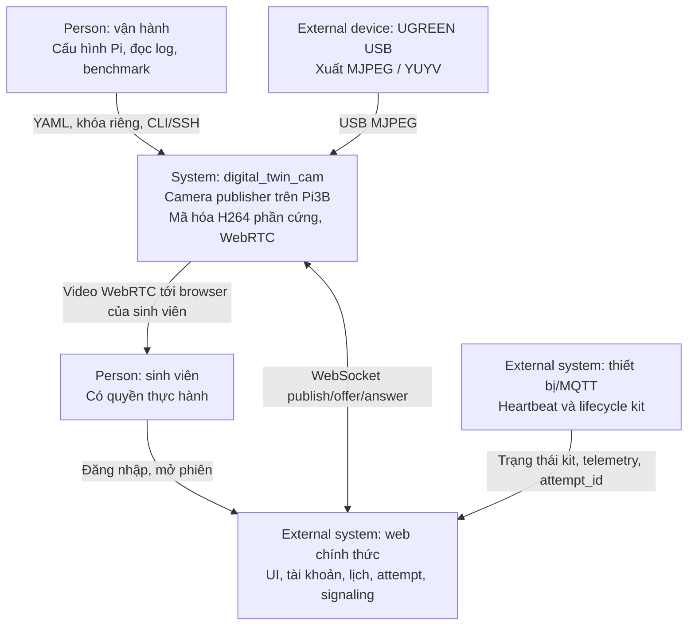

# C4 Level 1 — System context

## Mục tiêu và ranh giới

Thử thay nhánh Pi JPEG → PC VP8 bằng Pi tự encode H.264 phần cứng, giữ hợp đồng
signaling của web chính thức. PC chỉ dùng lập trình, vận hành/SSH hoặc mở browser;
không còn là nút bắt buộc để encode/chuyển video.

MQTT/telemetry và quyền xem nằm ngoài project. Một publisher đăng ký thành công
không đủ để kit online/lượt thực hành hợp lệ. Không giả lập dữ liệu để vượt lifecycle.
Server chính thức hiện không chuyển media; biểu diễn UI ở server không có nghĩa
server xử lý các frame. Nếu đổi yêu cầu thành media relay cần ADR và tích hợp riêng.
