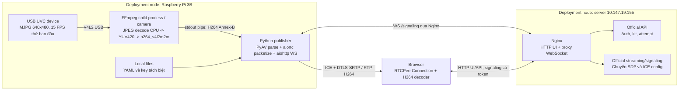

# C4 Level 2 — Containers

| Kênh | Mang gì | Không mang gì |
| --- | --- | --- |
| USB/V4L2 | JPEG của camera | Không phải giao thức Internet |
| FFmpeg stdout pipe | H.264 đã encode trong Pi | Không đi qua PC/HTTP MJPEG |
| WebSocket signaling | publish, offer/answer SDP, peerId, ICE config | Không chở frame video |
| WebRTC media | H264 đóng RTP rồi bảo vệ DTLS-SRTP; thường UDP | Không đi qua server chỉ vì server phục vụ UI |

Server do CNTT quản lý; project không build/chạy lại Node, Nginx hoặc database.
Một camera = một FFmpeg encoder, nhiều track nhận packet đã nén. Hai camera =
hai yêu cầu encode, cùng chia sẻ phần cứng Pi; khả năng đồng thời phải benchmark.
Một port signaling không tương ứng một encoder, một core hoặc một người xem.
