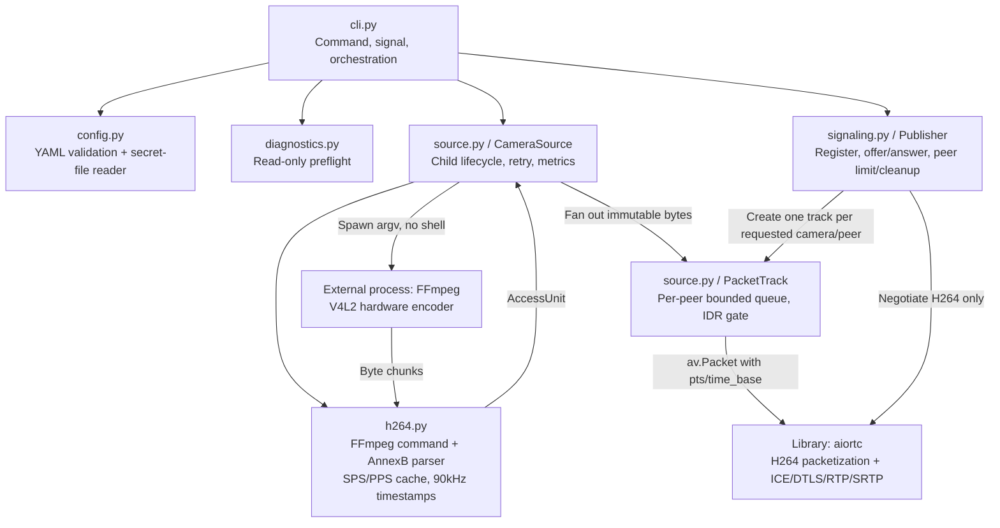

# C4 Level 3 — Components trong publisher

## Quy tắc dữ liệu

- PyAV `CodecContext.parse` tách access unit, không gọi `decode` trong publisher.
- Timestamp gán theo FPS cấu hình với time base 1/90000. Đây là timeline video,
  không phải timestamp tuyệt đối của cảm biến; cần đo trễ bằng đồng hồ trong hình.
- SPS được kiểm tra Constrained Baseline/level <=3.1; SPS/PPS được giữ và thêm lại ở IDR để người vào muộn bắt đầu giải mã được.
- Queue mỗi track tối đa 2 access units. Nếu tràn, xóa chuỗi frame phụ thuộc, đợi IDR kế tiếp.
  Không nối tùy tiện P-frame sau khi mất reference frame.
- aiortc nhận `av.Packet` nên gọi `H264Encoder.pack`, không encode lại pixel bằng
  `libx264`. Phiên bản dependency được pin; kiểm thử regression hai peer thực.
- H264 codec preferences đặt **trước** remote description để aiortc tính giao codec đúng.
- Encoder restart đóng track cũ, không trộn hai timeline/reference chain vào cùng track.
  Browser cần mở lại phiên video nếu track đã kết thúc; chưa tự giữ liên tục qua mọi lỗi USB.

## Trách nhiệm và giới hạn

`CameraSource` quản lý process, drain stderr để tránh deadlock, timeout nguồn,
retry có nghỉ và terminate/kill khi shutdown. `Publisher` giới hạn số **video peer
tracks**, timeout negotiate, đóng peers khi signaling mất. Không log secret/SDP.
`PacketTrack` chỉ phân phối bitstream; không tự điều khiển bitrate encoder theo REMB,
chưa chuyển PLI thành lệnh ép IDR cho driver. Đây là mục phải nghiệm thu trước production.
